<p align="center">
  
</p>

<h1 align="center">Live Scavenger Hunt</h1>

<p align="center"><strong>Find it. Show it. Beat the clock.</strong><br>
A live camera race that turns an expo booth into a moment the whole crowd can watch.</p>

<p align="center">
  <strong>2–6 players per heat</strong> &nbsp;·&nbsp;
  <strong>One shared arena</strong> &nbsp;·&nbsp;
  <strong>Optional audience voting</strong>
</p>

<p align="center"><a href="https://github.com/anthonyplusAI/twilio-live-scavenger-hunt"><strong>★ Star the project on GitHub</strong></a></p>

<p align="center">
  <a href="https://live-scavenger-hunt.delightfulwave-e00d5e3d.centralus.azurecontainerapps.io/e/live-scavenger-hunt/arena?demo=hunt&amp;players=4"><strong>▶ Open the hosted arena preview</strong></a>
  &nbsp;·&nbsp;
  <a href="https://live-scavenger-hunt.delightfulwave-e00d5e3d.centralus.azurecontainerapps.io/e/live-scavenger-hunt/play?demo=build"><strong>Explore the product story</strong></a>
</p>

<p align="center"><em>Read-only visual previews on the hosted app. A live heat uses the media mode shown in Operator → Preflight.</em></p>


<p align="center"><em>Illustrated arena preview. In a configured live event, each portrait spot carries that player's phone camera. The smaller star QR opens this repository.</em></p>

<p align="center">
  <a href="#the-experience">The experience</a> ·
  <a href="#see-the-moment">See the moment</a> ·
  <a href="#star-the-build">Star the build</a> ·
  <a href="#twilio-product-story">Twilio product story</a> ·
  <a href="#quick-start">Quick start</a> ·
  <a href="#azure-deployment">Azure deployment</a> ·
  <a href="#production-handoff">Production handoff</a>
</p>

## Watch the launch film

<!-- Video hosted as a GitHub user attachment. -->

{{GITHUB_VIDEO_URL}}

*61-second portrait film with music, fictional players, and staged app scenes.*

## The experience

A visitor scans the arena's prominent **Scan to play** QR. With **At join** lead capture, one initial phone form combines their screen name, the admin's configured contact fields (default: Name, Work email, optional Company), and consent to appear on the arena, including a brief result freeze, and to have camera images checked when enabled. Longer custom forms use short pages. The consent explains that OpenAI may review brief camera images when AI judging is enabled. Next, the visitor checks their camera; **Go live** reserves a spot only after it works. If access was denied, the phone shows where to allow it in the browser and a **Try camera again** button. A camera switch changes between front and rear cameras. New events ask for contact details only after a voluntary Twilio expert request; **Build guide** starts off until an admin enables it. Admins can turn capture off or change its timing. A visitor can choose **Watch and vote instead** without joining. New events hold the result celebration for 15 seconds by default, then the phone asks **Play again** or **Leave game**. Scanning the QR again in the same browser profile restores the event session and reuses any already captured lead without asking again.

Scanning the same event QR again in the same browser profile restores the event-scoped player token through `/me`. An active or queued player returns to their place without repeating the screen name or contact form; a finished player returns to the play-again decision, and someone who left can rejoin from a camera-off screen. The app stores the opaque token and a short camera-tab lease in browser storage, not contact field values. A different browser, device, private session, or cleared site storage may need a new join. If staff enabled At join after an earlier visit that captured no lead, the returner sees the current contact form once before rejoining.

The arena adjusts its portrait-card layout to the number of players. The phone requests portrait capture without forcing a crop; if a browser supplies a landscape track and supports canvas capture, the app letterboxes its full frame in a portrait stream for the phone and Twilio Video wall. Otherwise, the preview and arena tiles fit the browser's original frame within the portrait spot. The phone submits an uncropped, downscaled camera frame for judging; in live Video mode, wall evidence is a fallback when phone frames are missing or stale. The phone preview and wall use the same unmirrored left-to-right orientation, so printed words read correctly in both places. The clue stays sealed until the roster locks and the shared countdown reaches **GO**. Every screen uses the official Twilio bug mark for its browser icon.

When all configured player spots are occupied, or a heat has locked, a new visitor enters the next-heat waitlist with their camera off. Their phone shows a private, exact place in line and a capacity-based estimate in heats; the app does not promise a minute countdown because booth pauses and judging can vary. The oldest waiting visitor takes the next open lobby spot when someone leaves, is removed, times out, or an admin increases capacity. New arrivals and returning players cannot jump ahead. At the next heat, the oldest queued visitors get the available spots and reconnect their cameras. Auto-advance can open that next lobby after the result, but a heat in Operator mode still waits for staff to press **Start heat**.

The result celebration runs for the configured hold, then each phone asks **Another round?** with **Play again** and **Leave game**. If a phone receives the result late, it still shows the celebration for at least the shorter of eight seconds or the configured hold before asking; its camera stops at the server's result deadline. No response reserves no next-heat spot; the camera turns off. **Play again** keeps the same player ID, screen name, token, and captured lead, then takes an available lobby spot after earlier waiters or joins the queue. A returning player with a lobby spot has 30 seconds of active lobby time to reconnect and become ready. A booth pause freezes that window. If it expires, the slot goes to the next person, the phone returns to the decision, and the same player can try again without scanning. They stay out of later heats until they tap **Play again** once more. If they completed a heat, its win, loss, tie, or no-match outcome remains visible on the choice screen above the expired-spot guidance. **Leave game** releases the spot; a later scan in the same browser can offer rejoin. Staff still start each Operator-mode heat.

If staff correct the current result, the arena and phones still showing that heat update the winner or no-match outcome. This also works after the next lobby opens or a replay slot times out. A finished player who rescans in the same browser restores the result of their most recent completed heat, including any correction. Players who have since completed a newer heat keep its newer result.

If staff pause an open lobby, visitors can still join, connect their camera, and become ready. The arena keeps **Scan to play** visible even if a ballot was open; the phone says **Booth paused**. The join window begins or resumes only when staff resume the booth. A visitor who joins during a paused countdown or hunt waits in the next-heat queue. Paused phone screens show the hold without a misleading GO or expired round clock. The normal inactivity check still asks players to confirm their place during a long pause. The operator desk shows the frozen join clock and disables **Start heat** until staff resume; Operator start mode still needs a manual start afterward.

The Run screen starts at **Automatic draw**. Pressing **Start heat** then chooses an eligible clue randomly. To choose a specific next clue, an operator selects it under **Next challenge** and presses **Set next**. That saves one manual choice for the next heat; selecting a menu option alone does not schedule it. To return to the automatic draw, choose **Automatic draw** and press **Use auto**. This manual clue choice is separate from the visitor waitlist.

Automatic draws favor the least-played enabled prompts in the eligible priority tier and avoid an immediate repeat when another equally played clue exists. An audience category vote can narrow the draw. The standard hunt lasts **45 seconds**, with **60 seconds** for seeded creative clues; admins can change the event timer or a prompt's timer. The one-time upgrade applies these defaults only to untouched legacy events; customized timers stay saved. Everyone races to show the requested color, object, shape, printed tech word, or creative find. Seeded and newly added prompts default to AI-assisted judging. The upgrade switches prompts in untouched legacy events to AI-assisted judging; events already edited by an admin keep their saved judging choices. An admin can instead choose the built-in color detector, an audience vote, or booth-operator judgment. The operator can award one winner, several winners in a tie, or no match. The result lands on the arena **and** each player's phone.

Admins set each clue to **Standard** or **Low** rotation priority under **Operator → Prompts**. Simple color-only clues default to Low. The operator prompt deck and optional **Next challenge** menu display Standard clues first and Low clues afterward, keeping each group's saved order. After **Save prompt**, the deck follows the edited clue to its new page. This display order does not decide the next round. When any Standard clues are enabled, automatic rotation holds Low until every enabled Standard clue has appeared, then allows a Low clue at most once in five automatically selected rounds. An all-Low deck can draw a Low clue every round. It draws among the least-played clues in the chosen priority tier.

The seeded deck has **80 challenge ideas**, including 30 new conference Pilot clues for objects, printed Twilio and tech words, and simple prop pairings. Those 30 start disabled. An admin can test equal prop kits and camera judging at the venue, then turn on **Include in random draw** for approved clues. Printed-word clues use AI-assisted review of the camera frame; a dedicated card-only OCR detector is not implemented.

Audience category ballots are optional. Staff can open one from **Votes** when they want the crowd to steer the next clue type. **Auto category vote** starts off under **Event → Systems → Voting**; when enabled, a category ballot opens after every other completed heat and the next heat waits for it to close. Ballots honor the priority cadence; an operator can also choose an available category or set a specific next clue.

<p align="center">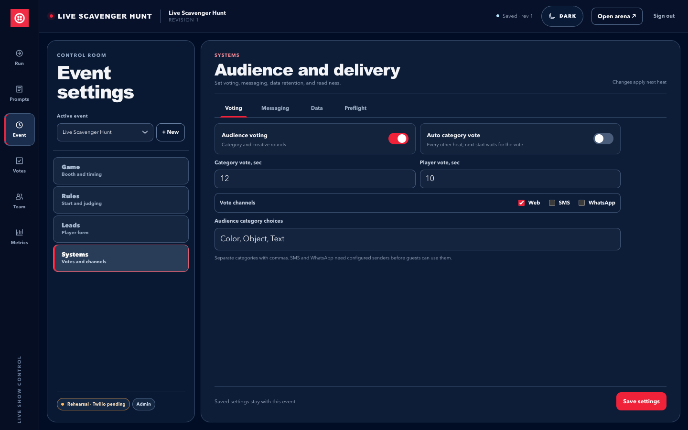</p>

<p align="center"><em>Local visual preview of voting settings. Staff can open a category ballot from Votes without enabling automatic ballots.</em></p>

<p align="center">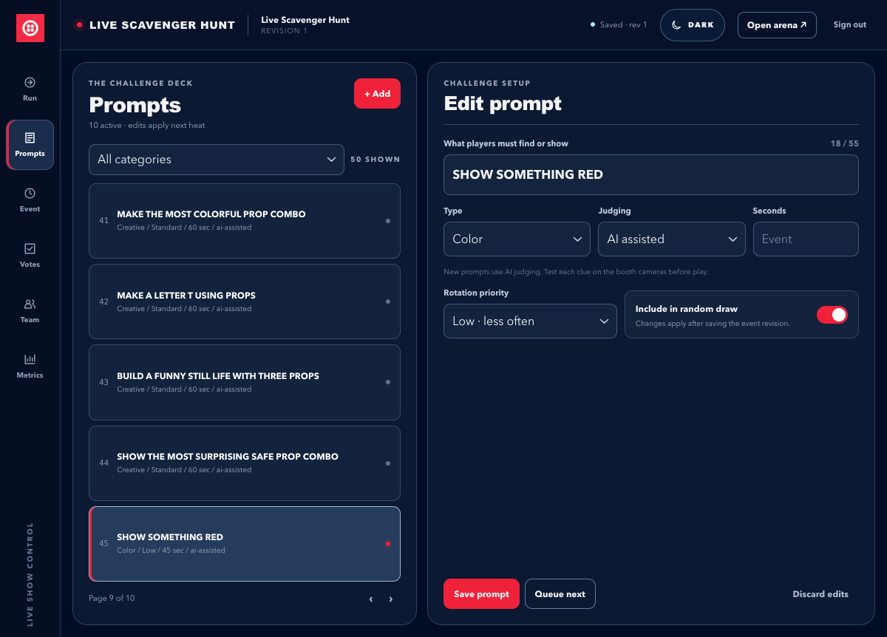</p>

<p align="center"><em>Local operator visual preview. Conference Pilot clues stay outside automatic rotation until an admin enables them.</em></p>

Spectators can take part through a web ballot without providing player details. With configured senders, SMS or WhatsApp ballots can steer the next challenge category or vote on a creative round. A paused ballot holds its remaining time; SMS and WhatsApp voters are told to resend if their message arrives during the hold. The arena's large **Scan to play** QR stays in the same place through every phase, including a vote, so visitors can join the current lobby or next-heat queue at any time. An open ballot adds a smaller **Vote now** QR; the repository remains a compact star link. Outside a ballot, booth-sized displays give the repository its own smaller QR. After playing, visitors can follow a visual phone-to-arena product story, open official Twilio pages for each featured product, and **star the source on GitHub** as the default main action. An admin can make an enabled follow-up, such as Twilio expert or a later-enabled build guide, the main action instead. Players and web spectators can voluntarily request the available follow-ups through the configured contact form; those requests do not subscribe visitors to product updates. The repo link also stays in the attendee phone footer throughout the journey and appears on the spectator ballot.

| Booth moment | What the app does |
| --- | --- |
| **Draw a crowd** | A large, responsive arena shows 2–6 portrait player spots, a persistent scan-to-play QR, a smaller vote QR during ballots, a GitHub star link, a shared clock, and a synchronized result reveal. |
| **Keep the race fair** | The server seals the prompt until GO. New events default to **Operator** start: staff press **Start heat** when the minimum is ready. Flexible, At capacity, and After wait remain optional automatic modes; existing events keep their saved choice. In timed modes, the join clock freezes during a booth pause. The waitlist fills vacant lobby spots in join order. A disconnected live Video player cannot submit a winning find. |
| **Keep staff in control** | Operators can pause, choose a prompt, judge or correct a result, award ties, and remove a player from the live heat or queue. If AI review fails, the automatic award holds for a manual winner, tie, or no-match decision. |
| **Manage booth access** | An admin can create local operators, change local usernames and passwords, or remove access from the control room. Optional Google sign-in grants verified `@twilio.com` Workspace accounts admin access. |
| **Measure engagement** | Private reports filter by event and date and cover join sessions, repeat entries, distinct browser sessions where available, plays, heats, votes, product and GitHub link clicks, leads, player exits, and removals. |
| **Adapt to the event** | Each event has its own URL, prompt deck, player limits, start rules, voting settings, lead timing and form, and main CTA. Every screen offers light/dark mode; the arena keeps its display controls hidden until staff interact. |

## See the moment

These are **visual previews** captured from the running app. Player illustrations and the labeled synthetic camera test pattern are stand-ins, not attendee feeds. The live arena uses camera feeds after Twilio Video setup; local rehearsal uses brief JPEG snapshots.

<table>
  <tr><th>Arena · first find</th><th>Arena · another player wins</th></tr>
  <tr>
    <td></td>
    <td></td>
  </tr>
  <tr><th>Phone · winner</th><th>Phone · not this round</th></tr>
  <tr>
    <td align="center"></td>
    <td align="center"></td>
  </tr>
</table>

<p align="center">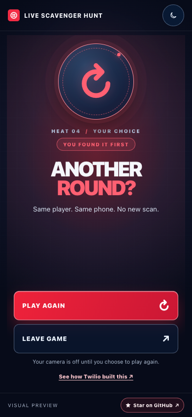</p>
<p align="center"><em>After the result hold, this separate choice screen opens. It is a read-only visual preview and does not reserve a player spot.</em></p>

The motion plays in the browser: the arena spotlights a first find and acknowledges the other players; the winning phone gets a medal and a short confetti burst. The non-winner's phone clearly identifies the outcome and winner. Ties and no-match outcomes have their own result states. The server keeps each locked player's original result tile if their camera disconnects or their session times out during the heat; someone who explicitly leaves before the result opts out, and staff removal excludes the player. On a signed-in arena wall, each included player's last available camera image freezes for the result hold, so the winner and other players remain visible if their phones stop publishing. The wall keeps a small, short-lived last-good image in browser memory during the heat; if a live image is unavailable at the result, it uses that image, then tries the server's transient frame cache, then the illustrated camera placeholder. It clears those wall-browser images at the next heat. New events hold the result for 15 seconds by default; admins can change that timer, and saved events keep their chosen duration. Motion reduces automatically when the device requests reduced motion.

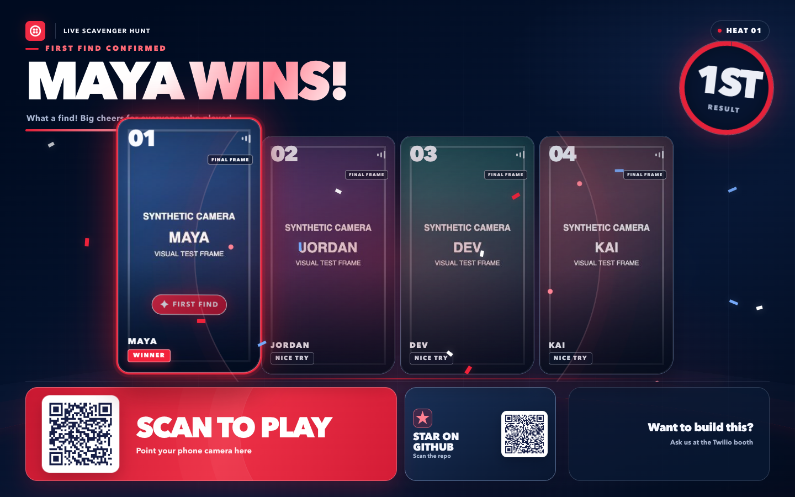

<p align="center"><em>Local synthetic camera fixture showing the final-frame treatment. These test patterns are not attendee feeds; no image is saved to the database.</em></p>

The lobby shows how many players are ready and whether it is waiting for the minimum or giving others time to join:

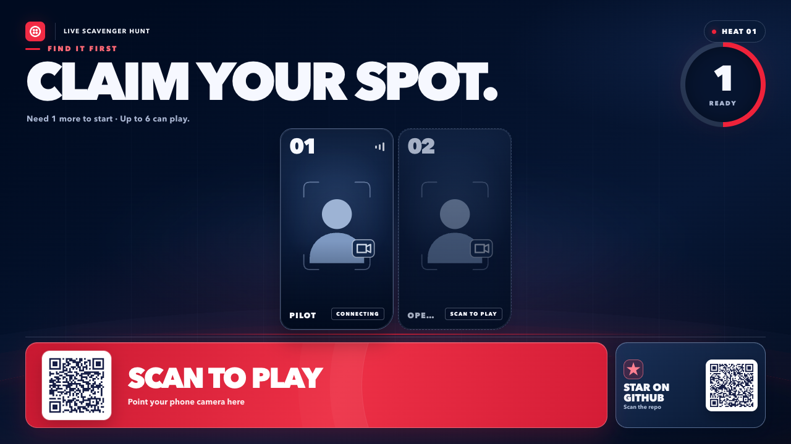

<p align="center"><em>Local visual preview with illustrated player spots; no live camera feed is shown.</em></p>

Visitors can also join while the booth is paused. The arena keeps the play QR visible, and a joined phone explains that its heat is on hold:

<table>
  <tr><th>Phone · joined during a pause</th><th>Arena · paused lobby</th></tr>
  <tr>
    <td align="center">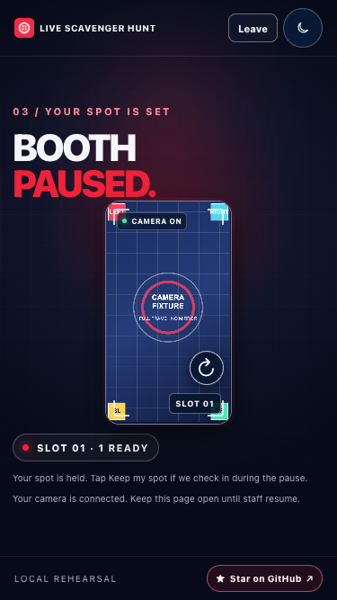</td>
    <td align="center">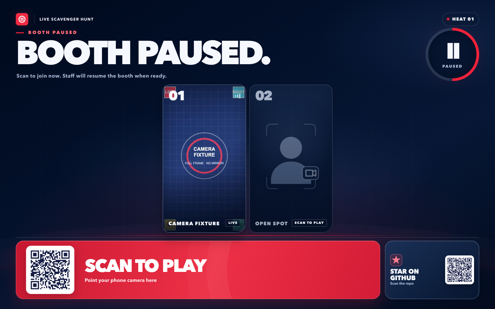</td>
  </tr>
</table>

<p align="center"><em>Local visual previews with a synthetic camera test pattern. No attendee feed or Twilio Video room is shown.</em></p>

<p align="center">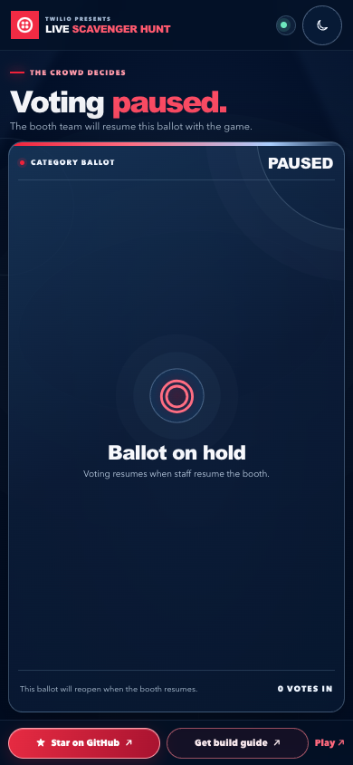</p>
<p align="center"><em>Local spectator visual preview. The ballot is still open and its remaining time resumes with the booth.</em></p>

The wall also rearranges for traffic at the booth:


The arena stays in show mode: only the Twilio identity and heat status remain at the top. **Scan to play** stays the dominant footer action, including during audience voting. An open ballot adds a smaller **Vote now** QR and keeps the [source repository](https://github.com/anthonyplusAI/twilio-live-scavenger-hunt) as a compact star link. Outside a ballot, the star card has its own QR on booth-sized displays. Moving a pointer, touching the screen, or pressing Tab reveals Operator, theme, and media controls for staff; the strip hides again after five seconds of inactivity.

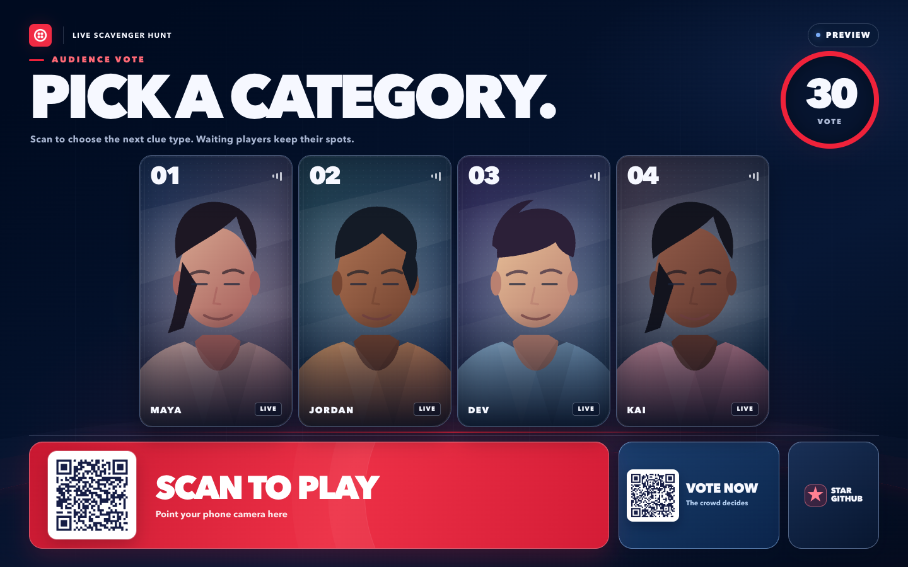

<p align="center"><em>Local visual preview of an open category ballot. Player portraits are illustrations, not live camera feeds; both QR codes serve different visitor actions.</em></p>

After starting the app, open the read-only [four-player hunt](http://127.0.0.1:65111/e/live-scavenger-hunt/arena?demo=hunt&players=4), [category vote](http://127.0.0.1:65111/e/live-scavenger-hunt/arena?demo=vote&players=4), [arena win](http://127.0.0.1:65111/e/live-scavenger-hunt/arena?demo=win), [arena loss](http://127.0.0.1:65111/e/live-scavenger-hunt/arena?demo=lose), [phone win](http://127.0.0.1:65111/e/live-scavenger-hunt/play?demo=win), [phone loss](http://127.0.0.1:65111/e/live-scavenger-hunt/play?demo=lose), [play-again decision](http://127.0.0.1:65111/e/live-scavenger-hunt/play?demo=decision), or [product story](http://127.0.0.1:65111/e/live-scavenger-hunt/play?demo=build) preview. Use **Replay reveal** on a result screen to watch the animation again. Preview URLs do not start a heat, connect a camera, judge a player, collect leads, or write metrics; their outbound links still open the linked sites.

## Star the build

The arena keeps the game QR large. Outside a ballot, the [source repository](https://github.com/anthonyplusAI/twilio-live-scavenger-hunt) has a smaller star card with its own QR on booth displays; during voting, the vote QR takes that space and the repository stays as a compact star link. The player phone and spectator ballot keep **Star on GitHub** visible in their compact footers. Admin reports attribute GitHub referrals to the phone, ballot, wall QR, or wall link; they count outbound taps and scans, not confirmed visits or stars.

<table>
  <tr><th>Player phone · before joining</th><th>Player phone · optional guide form</th><th>Spectator phone · between ballots</th></tr>
  <tr>
    <td align="center"></td>
    <td align="center"></td>
    <td align="center"></td>
  </tr>
</table>

<p align="center"><em>Local visual previews. The player portrait is an illustration, not a live camera feed. The guide form shows a configured after-play event with Build guide enabled; new events start with that option off.</em></p>

<p align="center">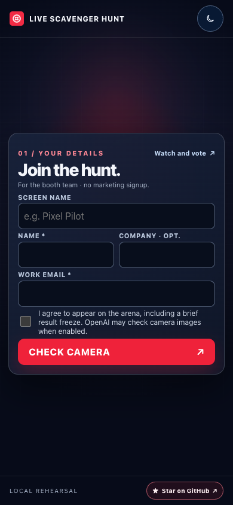</p>
<p align="center"><em>Local visual preview of the optional At join setting. The blank form collects no test contact, and the next step is the camera check.</em></p>

<table>
  <tr><th>Camera access · recover and retry</th><th>Spectator · voluntary follow-up</th></tr>
  <tr>
    <td align="center">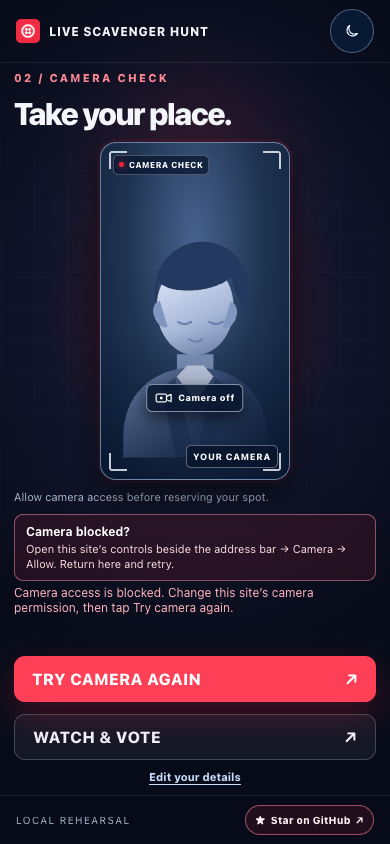</td>
    <td align="center">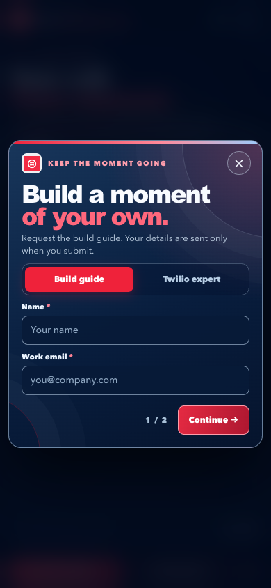</td>
  </tr>
</table>

<p align="center"><em>Local interface previews of recovery and an optional configured guide follow-up; no live camera feed appears.</em></p>

<p align="center">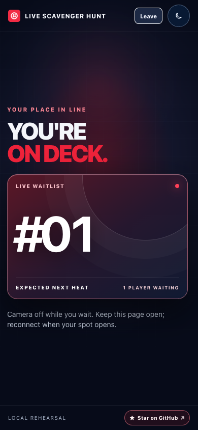</p>
<p align="center"><em>Local visual preview of the waitlist. The card shows a queue rank and an estimate in heats, not a live camera feed or a guaranteed time.</em></p>

## Twilio product story

The post-heat CTA opens a one-screen visual explanation: a phone camera reaches the arena through **Twilio Video** in a configured live event. Visitors can tap **Messaging** to see how SMS or WhatsApp ballots work, or **Segment** to see how game activity becomes engagement data. The screen keeps optional integrations distinct from the core Video path. Its main action is **Star this game on GitHub** by default; an admin can select an enabled follow-up instead. New events offer **Twilio expert** and start with **Build guide** off.

Each product panel links to its official Twilio page: [Video](https://www.twilio.com/en-us/video), [Programmable Messaging](https://www.twilio.com/en-us/messaging/apis/programmable-messaging-api), or [Segment](https://www.twilio.com/en-us/segment). The phone's **Star on GitHub** link is visible from joining through the result and product story. With the default after-play setting, an expert tap opens the short configured contact form; a guide tap does so only after an admin enables **Build guide**. The confirmation screen links back to the product story, where a compatible second request reuses saved contact details. If the admin chose at-join capture, a request uses the details already saved at join.

<table>
  <tr><th>Dark display</th><th>Light display</th></tr>
  <tr>
    <td align="center"></td>
    <td align="center"></td>
  </tr>
</table>

<p align="center"><em>Read-only visual previews. Contact collection happens only when someone takes a configured follow-up action, unless the admin selects at-join capture.</em></p>

| Product | Role in the activation | Setup state |
| --- | --- | --- |
| **Twilio Video** | Phone cameras publish into an unrecorded room; the booth wall subscribes to the players' video. | Built in; needs the Account SID, API Key SID and secret, Auth Token, and a public HTTPS origin for a live event. |
| **Twilio Messaging** | Spectators send SMS or WhatsApp ballots and receive an automated TwiML acknowledgment reply. A web ballot is available without a sender. | Optional; needs event senders, inbound webhook setup, and registration that covers the replies. |
| **Twilio Segment** | Can mirror a limited, contact-free activity stream using an anonymous browser session ID. The local report works without Segment. | Optional Write Key. Lead identities are not sent to Segment. |
| **Twilio SendGrid** | Can email a requested build guide when outbound email is enabled. Accepted sends are tracked separately from confirmed delivery; an admin can follow expert requests in a private queue. | Off by default. Requires `SENDGRID_EMAIL_ENABLED=1`, an API key, an authenticated sending domain and matching From address. A signed Event Webhook confirms delivery. |

Prompts use **OpenAI vision** by default when its server key is configured. On upgrade, only untouched revision-1 legacy events switch existing prompts to AI-assisted judging; customized events keep their saved judging modes. Without an OpenAI key, an operator must judge AI-assisted rounds. The booth operator can always review or override a decision. The expert CTA records a request; it does **not** place a Voice call or launch Agent Connect.

## Player safety and booth control

The camera check happens before joining, so a denied permission cannot hold a tile; the phone offers a retry and browser settings guidance. Once joined, a player can leave a spot, queue, or active heat from the phone. The result holds its celebration, then a separate **Another round?** screen offers **Play again** and **Leave game**. Replay keeps the player ID, screen name, saved contact details, and event token without repeating the join form or creating a second lead. It places the player after anyone already waiting and records another heat entry. No choice holds no new spot. The camera turns off between heats and reconnects when a new spot opens, with a reconnect button if permission or media setup needs attention. **Leave game** releases the spot, turns off the camera, and leaves a one-tap rejoin path on the same phone.

A phone left idle in the queue, lobby, paused heat, or operator review asks after three minutes and releases the spot after another 30 seconds. An abandoned Leave confirmation also releases after 30 seconds. If the tab closes or stops sending heartbeats, the server clears waiting players after about 25 seconds and in-progress players after about 60 seconds. The camera stops at the end of the configured result display, with a time limit even if the result is paused.

<p align="center"></p>
<p align="center"><em>Next-heat visual preview. The portrait is an illustration; no live camera is shown.</em></p>

The operator desk makes a paused booth explicit: **Resume** stays available, **Resume to start** is disabled, and a join window that has not opened shows **not started**.

<p align="center">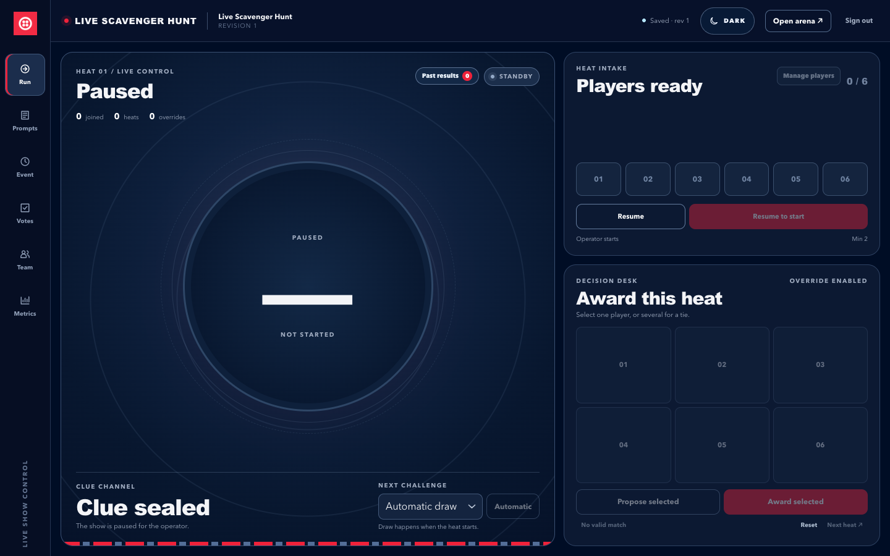</p>
<p align="center"><em>Local operator visual preview. Automatic draw is selected; no specific clue is scheduled. No attendee feeds, lead data, or live event activity are shown.</em></p>

<p align="center">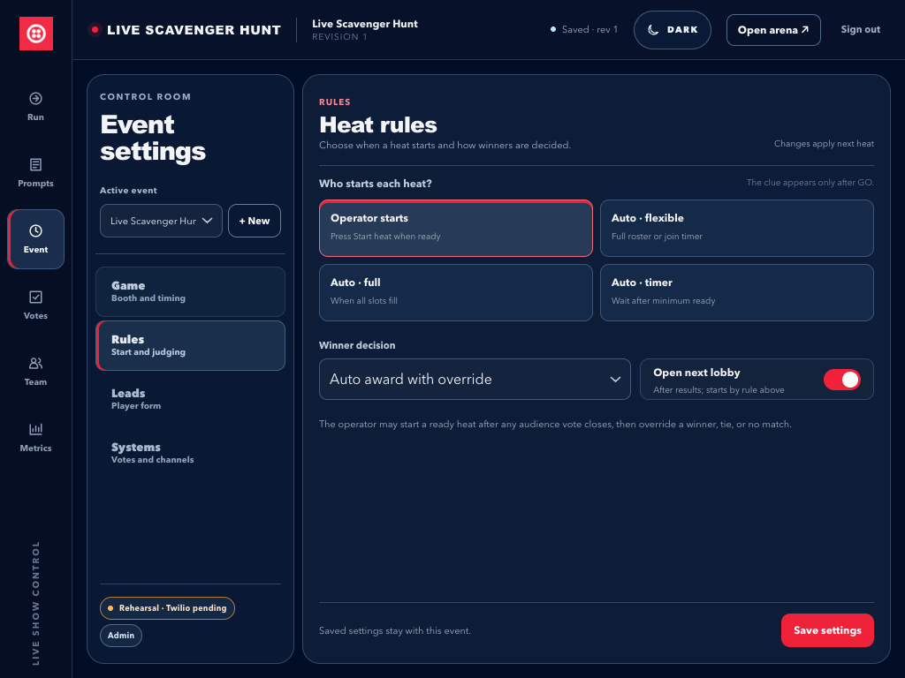</p>
<p align="center"><em>Local settings visual preview. Opening the next lobby does not start a manual heat; staff press Start heat when players are ready.</em></p>

Staff can open **Manage players** in the operator view, choose a current or queued player, and confirm removal. Removal clears the slot, requests a Twilio Video disconnect when configured, invalidates that player session, and records a removal metric. The command reports whether the Video disconnect succeeded. This is session-level moderation: a person with a new browser session can scan again, so booth staff should monitor the arena.

## Quick start

Requires **Node.js 26+**. No Twilio credentials are needed for a local rehearsal.

```sh
npm ci
npm start
```

`npm start` builds the browser Video client before starting the server. On a new local database, the terminal prints a generated admin username and one-time password. Save the password, then open:

| Screen | Local URL |
| --- | --- |
| Arena wall | [Open arena](http://127.0.0.1:65111/e/live-scavenger-hunt/arena) |
| Player phone | [Open player](http://127.0.0.1:65111/e/live-scavenger-hunt/play) |
| Spectator ballot | [Open vote](http://127.0.0.1:65111/e/live-scavenger-hunt/vote) |
| Operator and event settings | [Open control room](http://127.0.0.1:65111/e/live-scavenger-hunt/operator) |
| Private metrics and leads | [Open metrics](http://127.0.0.1:65111/e/live-scavenger-hunt/metrics) |

The default server address is `127.0.0.1:65111`; adjust it with [.env.example](.env.example). Local rehearsal sends short-lived JPEG camera frames through the app at a lower frame rate than Twilio Video. Camera access on real phones requires a reachable **HTTPS** origin. Sign in as an operator in the same browser profile used for the arena wall to see player cameras there.

Hosted deployments can provide `BOOTSTRAP_ADMIN_PASSWORD` as a platform secret on first boot. The app then seeds the admin without printing the credential in retained server logs. Changing that secret after the first boot does not change the saved password; use **Team → Admin login** to update the existing account.

### Booth staff sign-in

The first local admin account is `admin`. In **Team → Admin login**, an admin can edit that existing account: leave the username as `admin` and enter a new password to reset it, change the username, or do both. A Google admin does not need the old local password. This updates the saved account and signs out its existing sessions. **Add operator** creates a separate staff account and cannot reuse `admin`. Team also lets admins create and manage local operators. Local passwords have no minimum length or character rule; any nonempty value up to a 16 KB request-safety ceiling works. Google account names and passwords remain managed by Google. Operators can run heats but cannot edit event settings, see leads or metrics, or manage other accounts. **Team** and **Metrics** appear only for admins. Local accounts work without Google or Twilio credentials.

Google sign-in is optional and appears when an OAuth client ID and secret are configured. Any Google identity with a verified `@twilio.com` address **and** the `twilio.com` Workspace claim receives admin access, including **Team**, **Metrics**, and leads. The server checks the signed ID token and tracks the stable Google subject rather than trusting the address alone. An existing Google operator gains admin access on their next verified sign-in. The [Azure setup guide](docs/INFRA_SETUP.md#optional-google-sign-in-for-twilio-admins) shows the exact callback URL and secret setup.

<table>
  <tr><th>Staff sign-in</th><th>Admin · Team</th></tr>
  <tr>
    <td></td>
    <td></td>
  </tr>
</table>

<p align="center"><em>Local visual previews. The Google button appears when OAuth credentials are configured.</em></p>

Run `npm run check` for the browser build, server tests, and README link check. The [runbook](docs/runbook.md) covers event setup, accounts, preflight, messaging registration, data care, and a full booth rehearsal.

## Metrics and leads

The admin-only Metrics view filters by event and date range, shows the engagement funnel and outbound **Twilio page** and **GitHub repo** click counts, and exports filtered event or lead CSV. Twilio clicks are broken down by Video, Messaging, and Segment; GitHub referrals are attributed to the player phone, spectator ballot, arena QR, or arena link. These are outbound actions, not confirmed page loads or GitHub stars. Join sessions and repeat heat entries are counted separately from distinct browser sessions and distinct player IDs; none is a verified count of unique people. Older joins without a session ID are identified as unattributed. Local reports persist in SQLite even when Segment is not configured.

Lead capture can be turned off per event. When enabled, an admin chooses whether to ask at join or after play, the main post-heat action, and up to eight contact fields. New events default to **After play**, **Star on GitHub**, **Twilio expert** enabled, and **Build guide** off; existing saved event choices are unchanged. With At join, the default three contact fields fit beside screen name and consent on one phone form; longer custom forms paginate before camera check. A returning browser session with a captured lead does not submit another. If At join is switched on after a player joined without a lead, the current form appears once before that player replays. Guide or expert requests open a voluntary form after play when that event option is enabled; an admin can turn off **Build guide** without turning off lead capture or the expert CTA. A second request can reuse compatible contact details from the first. Web spectators can request either enabled follow-up without joining a heat. Every lead keeps a snapshot of the fields shown. Metrics separate leads, guide requests, accepted and delivered guide email, delivery failures, and an expert follow-up queue that staff can mark contacted. Guide and expert counts use their request dates in the selected range; the lead roster and CSV use capture date. New requests do not create marketing subscriptions or send lead identity to Segment. A guide requested while outbound email is off is saved as `pending-configuration` without a send attempt. Saved `waiting-config` guide jobs can send automatically after re-enabling outbound email, so review old requests first. A guide requested for the same event and email within 24 hours is recorded without sending another email. With email enabled, SendGrid Mail Send acceptance means the request reached SendGrid; a configured signed Event Webhook confirms delivery or reports a bounce/drop. SendGrid HTTP 503 and uncertain network outcomes require staff review before any resend.

<table>
  <tr><th>Admin · lead timing and main action</th><th>Admin · configurable contact fields</th></tr>
  <tr>
    <td>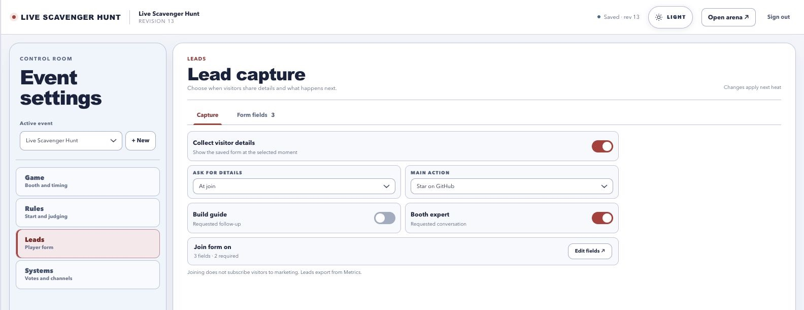</td>
    <td>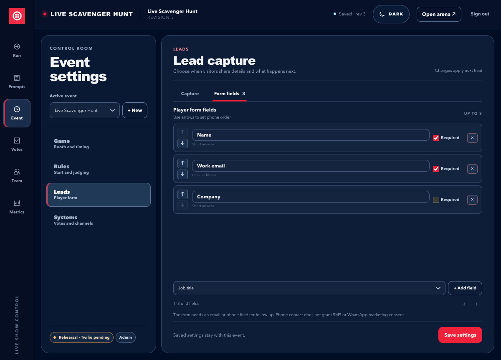</td>
  </tr>
  <tr><th>Admin · engagement overview</th><th>Admin · captured leads</th></tr>
  <tr>
    <td>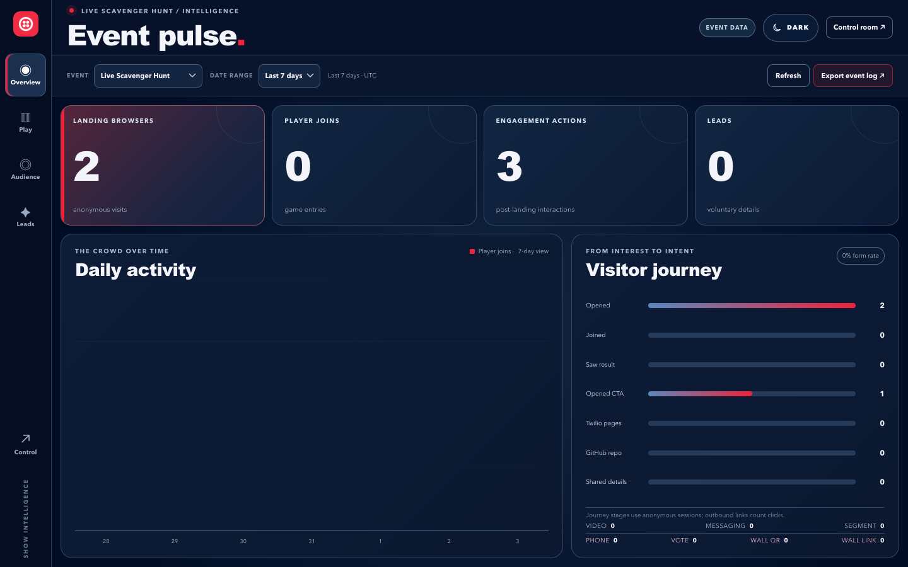</td>
    <td>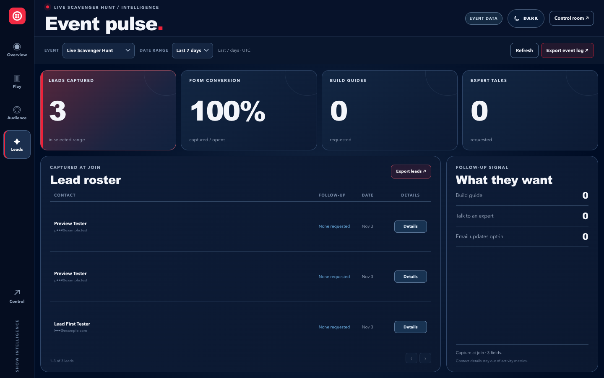</td>
  </tr>
</table>

<p align="center"><em>The lead settings image is a cropped view of the current hosted event configuration with no attendee data. Other images are local visual previews with synthetic test contacts. New events default to After play and Build guide off; this hosted event uses At join.</em></p>

The app stores event configuration, heat history, votes, metrics, and captured leads and follow-up requests in SQLite. Video is not recorded by this app, and camera evidence JPEGs are kept briefly in memory rather than saved to the database. Lead retention is configurable per event.

## Architecture

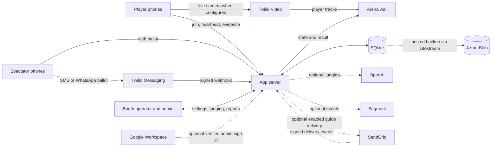

The server owns the round clock, sealed clue, slot assignment, winner decision, operator permissions, and event-scoped reports. The [API contract](docs/full-app-api.md) lists routes and payloads; the [challenge library](docs/concepts/find-it-first-challenge-library.md) helps plan an event prompt deck.

## Azure deployment

The [hosted arena](https://live-scavenger-hunt.delightfulwave-e00d5e3d.centralus.azurecontainerapps.io/e/live-scavenger-hunt/arena) runs on Azure Container Apps. Provisioning starts it in rehearsal mode; the operator **Preflight** view reports the current media configuration and optional integrations. Its public HTTPS URL supports phone camera permissions, and the four Twilio Video and Auth Token settings enable live Rooms. Local passwords work without Google; Google sign-in appears when its OAuth client credentials are deployed.

The Azure setup follows the Birdies & Eagles pattern: a dedicated resource group in `centralus`, private Container Registry, Container Apps environment, Log Analytics, and GitHub OIDC deploys. The app keeps SQLite on fast local container storage and uses Litestream to restore and replicate it to a private Azure Blob container. An Azure Blob lease allows only one replica to open the database, including during platform maintenance. A controlled rollout stops the previous game process before the replacement starts, so a release includes a brief planned pause. The Container App serves a public HTTPS URL and is configured for one replica.

Start with [one-time infrastructure setup](docs/INFRA_SETUP.md), then use the [deployment guide](docs/DEPLOYMENT.md) for releases, backup checks, and recovery. [CI details](docs/CICD.md) describe the `Validate` gate that runs before an image can deploy. GitHub Actions can activate live Video through the controlled rollout with four Twilio secrets and `TWILIO_VIDEO_MODE=live`; `rehearsal` switches back to snapshots, and an unset mode preserves the current setting. The rollout batches credentials selected for active integrations after stopping the old writer, then waits for Azure provisioning and verifies secret names. Azure operation conflicts may extend the planned pause, so the [failed rollout steps](docs/DEPLOYMENT.md#failed-rollout-recovery) cover manual recovery. The same rollout accepts optional OpenAI and Segment keys. Outbound guide email stays off until `SENDGRID_EMAIL_ENABLED=1` is deployed with the SendGrid API key and a From address on an authenticated domain. Setting the GitHub Actions variable to `0` and deploying removes the Mail Send key and sender environment references from the replacement revision, while keeping the stored GitHub secret for later use. Lead capture, local metrics, Segment, Video, and SMS are independent of this switch. A signed Event Webhook and its public verification key are needed to confirm previous or future guide deliveries. Segment receives only the limited activity stream under anonymous browser session IDs; lead identities are not sent. Litestream attempts to sync every second when Blob is healthy; backup lag can grow during a storage outage. Verify a current backup and restore before an event.

## Production handoff

**The Azure deployment path is included and starts in rehearsal mode.** Before opening a public booth, add the Account SID, US1 Standard API Key SID and secret, and account Auth Token as GitHub Actions secrets; set `TWILIO_VIDEO_MODE=live` and deploy between heats. Verify the Blob backup and restore, then test the wall with real phones on the venue network, including a denied camera and a front/rear switch. SMS/WhatsApp ballots are optional and need an inbound sender webhook plus registration for automated acknowledgment replies. AI vision, Segment, and SendGrid are optional integrations with [separate setup](docs/INFRA_SETUP.md#activate-optional-ai-segment-and-guide-email). Outbound guide email is off by default; keep the event's **Build guide** action off while the sender is unavailable. If enabling SendGrid later, confirm both API acceptance and a signed delivery event; without the webhook, requests remain accepted but delivery is unconfirmed. Follow the [Twilio activation steps](docs/INFRA_SETUP.md#activate-twilio-video) and [runbook's handoff checklist](docs/runbook.md#8-production-handoff-checklist).

When changing app behavior, screens, settings, or integrations, update this README and the relevant runbook/API sections in the same change. [Project guidance](AGENTS.md) records that maintenance rule.
