<p align="center">
  
</p>

<h1 align="center">Live Scavenger Hunt</h1>

<p align="center"><strong>Find it. Show it. Beat the clock.</strong><br>
A live camera race that turns an expo booth into a moment the whole crowd can watch.</p>

<p align="center">
  <strong>2–6 players per heat</strong> &nbsp;·&nbsp;
  <strong>One shared arena</strong> &nbsp;·&nbsp;
  <strong>Optional audience voting</strong>
</p>

<p align="center"><a href="https://github.com/anthonyplusAI/twilio-live-scavenger-hunt"><strong>★ Star the project on GitHub</strong></a></p>

<p align="center">
  <a href="https://live-scavenger-hunt.delightfulwave-e00d5e3d.centralus.azurecontainerapps.io/e/live-scavenger-hunt/arena?demo=hunt&amp;players=4"><strong>▶ Open the hosted arena preview</strong></a>
  &nbsp;·&nbsp;
  <a href="https://live-scavenger-hunt.delightfulwave-e00d5e3d.centralus.azurecontainerapps.io/e/live-scavenger-hunt/play?demo=build"><strong>Explore the product story</strong></a>
</p>

<p align="center"><em>Read-only previews on the Azure rehearsal deployment. Live Twilio Video awaits account configuration.</em></p>

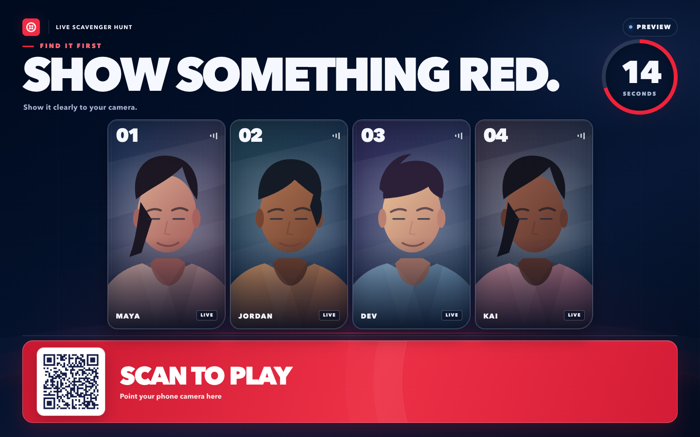

<p align="center"><em>Illustrated arena preview. In a configured live event, each portrait spot carries that player's phone camera. The smaller star QR opens this repository.</em></p>

<p align="center">
  <a href="#the-experience">The experience</a> ·
  <a href="#see-the-moment">See the moment</a> ·
  <a href="#star-the-build">Star the build</a> ·
  <a href="#twilio-product-story">Twilio product story</a> ·
  <a href="#quick-start">Quick start</a> ·
  <a href="#azure-deployment">Azure deployment</a> ·
  <a href="#production-handoff">Production handoff</a>
</p>

## The experience

A visitor scans the arena's prominent **Scan to play** QR, picks a screen name, agrees to appear on the booth display and have camera images checked for matches, checks their phone camera, and joins the heat. The consent screen explains that OpenAI may review brief images when AI judging is enabled. The phone checks the 2–20 character name and consent inline and shows progress while it saves a spot. The arena adjusts its portrait-card layout to the number of players. The clue stays sealed until the roster locks and the shared countdown reaches **GO**. Every screen uses the official Twilio bug mark for its browser icon.

The next clue is drawn randomly from enabled prompts that have not appeared in the current deck cycle. An operator can choose the next clue, and an audience category vote can narrow the draw. After every enabled clue has appeared, a new cycle begins without immediately repeating the last clue. The standard hunt now lasts **45 seconds**, with **60 seconds** for seeded creative clues; admins can change the event timer or a prompt's timer. Everyone races to show the requested color, object, shape, printed tech word, or creative find. Prompts default to AI-assisted judging; an admin can instead choose the built-in color detector, an audience vote, or booth-operator judgment. The operator can award one winner, several winners in a tie, or no match. The result lands on the arena **and** each player's phone.

Spectators can take part through a web ballot. With configured senders, SMS or WhatsApp ballots can steer the next challenge category or vote on a creative round. After playing, visitors can tap **Play next heat** without entering their name again, or **Leave game** to end their session and turn off the camera. They can also follow a visual phone-to-arena product story, open official Twilio pages, and voluntarily request a guide or a conversation with the booth team. Those requests do not subscribe visitors to product updates. A small **Star on GitHub** card sits beside the arena's larger play or vote QR; booth-sized displays show a second QR in the card. The repo link also stays in the attendee phone footer throughout the journey and appears on the spectator ballot. Joining and voting never require a lead form.

| Booth moment | What the app does |
| --- | --- |
| **Draw a crowd** | A large, responsive arena shows 2–6 portrait player spots, a prominent scan-to-play QR, a smaller GitHub star QR on booth displays, a shared clock, and a synchronized result reveal. |
| **Keep the race fair** | The server seals the prompt until GO. Start rules and timers are set per event; an operator can start a ready heat manually. |
| **Keep staff in control** | Operators can pause, choose a prompt, judge or correct a result, award ties, and remove a player from the live heat or queue. |
| **Manage booth access** | An admin can create local operators, change local usernames and passwords, or remove access from the control room. Optional Google sign-in grants verified `@twilio.com` Workspace accounts admin access. |
| **Measure engagement** | Private reports filter by event and date and cover joins, repeat entries, plays, heats, votes, product and GitHub link clicks, leads, player exits, and removals. |
| **Adapt to the event** | Each event has its own URL, prompt deck, player limits, start rules, voting settings, and lead form. Every screen offers light/dark mode; the arena keeps its display controls hidden until staff interact. |

## See the moment

These are **visual previews with illustrated stand-ins**, captured from the running app. The live arena uses camera feeds after Twilio Video setup; local rehearsal uses brief JPEG snapshots.

<table>
  <tr><th>Arena · first find</th><th>Arena · another player wins</th></tr>
  <tr>
    <td>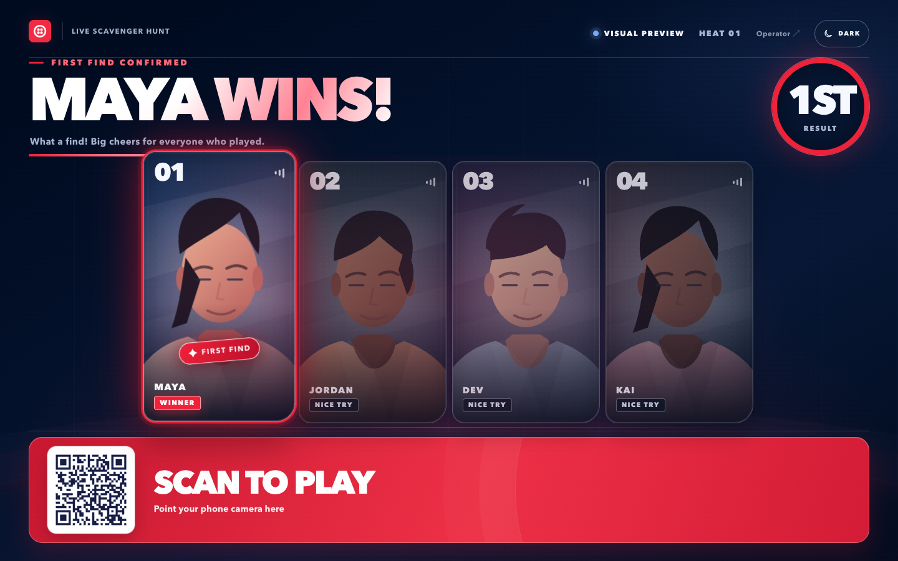</td>
    <td>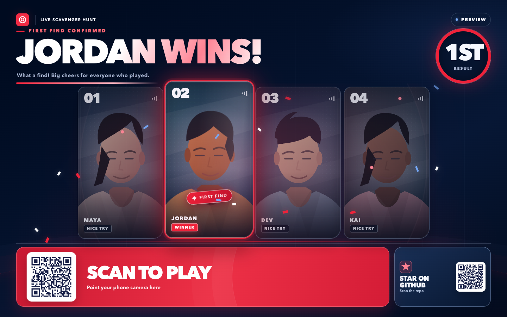</td>
  </tr>
  <tr><th>Phone · winner</th><th>Phone · not this round</th></tr>
  <tr>
    <td align="center">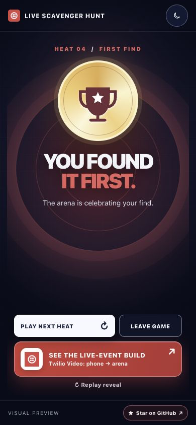</td>
    <td align="center">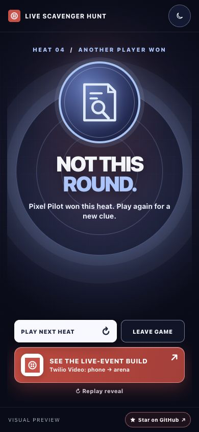</td>
  </tr>
</table>

The motion plays in the browser: the arena spotlights a first find and acknowledges the other players; the winning phone gets a medal and a short confetti burst. The non-winner's phone clearly identifies the outcome and winner. Ties and no-match outcomes have their own result states. Motion reduces automatically when the device requests reduced motion.

The wall also rearranges for traffic at the booth:

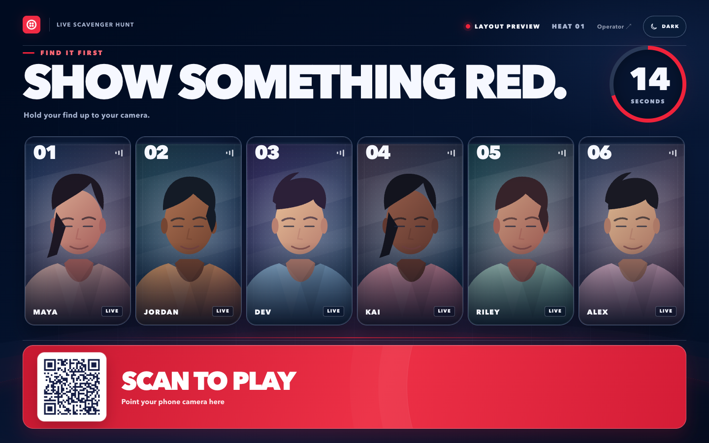

The arena stays in show mode: only the Twilio identity and heat status remain at the top. Its play or vote QR remains the dominant footer action; a smaller star card lets visitors scan through to the [source repository](https://github.com/anthonyplusAI/twilio-live-scavenger-hunt) on booth-sized displays and remains a clickable link on compact screens. Moving a pointer, touching the screen, or pressing Tab reveals Operator, theme, and media controls for staff; the strip hides again after five seconds of inactivity.

After starting the app, open the read-only [four-player hunt](http://127.0.0.1:65111/e/live-scavenger-hunt/arena?demo=hunt&players=4), [arena win](http://127.0.0.1:65111/e/live-scavenger-hunt/arena?demo=win), [arena loss](http://127.0.0.1:65111/e/live-scavenger-hunt/arena?demo=lose), [phone win](http://127.0.0.1:65111/e/live-scavenger-hunt/play?demo=win), [phone loss](http://127.0.0.1:65111/e/live-scavenger-hunt/play?demo=lose), or [product story](http://127.0.0.1:65111/e/live-scavenger-hunt/play?demo=build) preview. Use **Replay reveal** on a result screen to watch the animation again. Preview URLs do not start a heat, connect a camera, judge a player, collect leads, or write metrics; their outbound links still open the linked sites.

## Star the build

The arena keeps the game QR large and gives the [source repository](https://github.com/anthonyplusAI/twilio-live-scavenger-hunt) a smaller star card with its own QR on booth displays. The player phone and spectator ballot keep **Star on GitHub** visible in their compact footers. Admin reports attribute GitHub referrals to the phone, ballot, wall QR, or wall link; they count outbound taps and scans, not confirmed visits or stars.

<table>
  <tr><th>Player phone · before joining</th><th>Player phone · consent check</th><th>Spectator phone · between ballots</th></tr>
  <tr>
    <td align="center">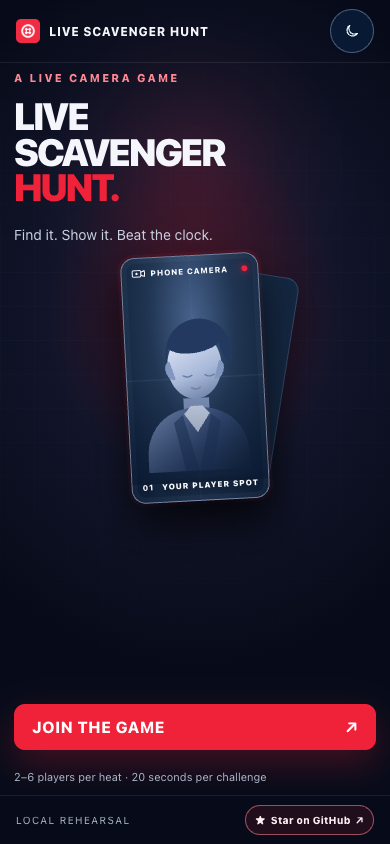</td>
    <td align="center">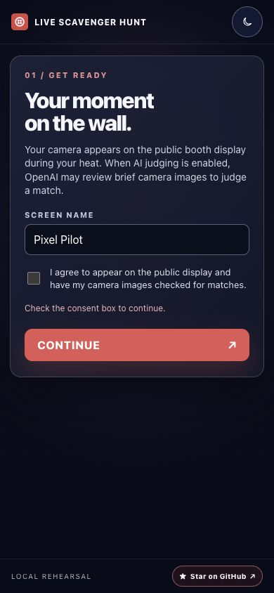</td>
    <td align="center">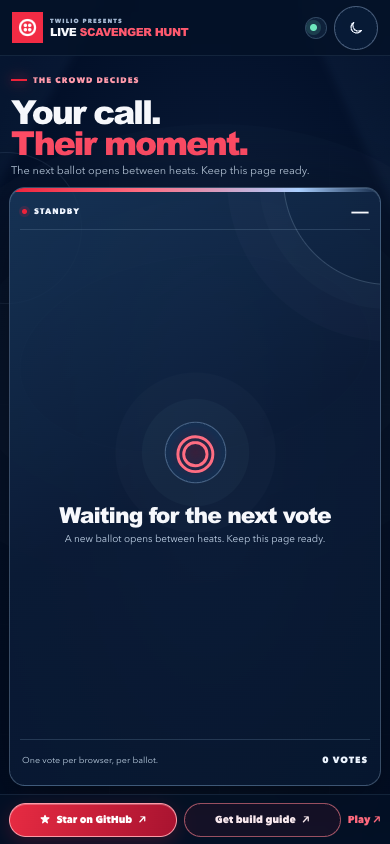</td>
  </tr>
</table>

<p align="center"><em>Local phone previews. The player portrait is an illustration, not a live camera feed; the consent screen explains optional OpenAI review and shows the missing-checkbox message; the spectator ballot is waiting for its next vote.</em></p>

## Twilio product story

The post-heat CTA opens a one-screen visual explanation: a phone camera reaches the arena through **Twilio Video** in a configured live event. Visitors can tap **Messaging** to see how SMS or WhatsApp ballots work, or **Segment** to see how game activity becomes engagement data. The screen keeps optional integrations distinct from the core Video path.

Each product panel links to its official Twilio page: [Video](https://www.twilio.com/en-us/video), [Programmable Messaging](https://www.twilio.com/en-us/messaging/apis/programmable-messaging-api), or [Segment](https://www.twilio.com/en-us/segment). The phone's **Star on GitHub** link is visible from joining through the result and product story, including the optional follow-up form.

<table>
  <tr><th>Dark display</th><th>Light display</th></tr>
  <tr>
    <td align="center">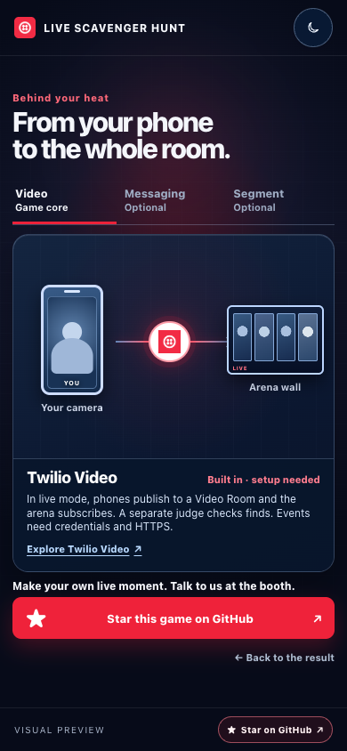</td>
    <td align="center">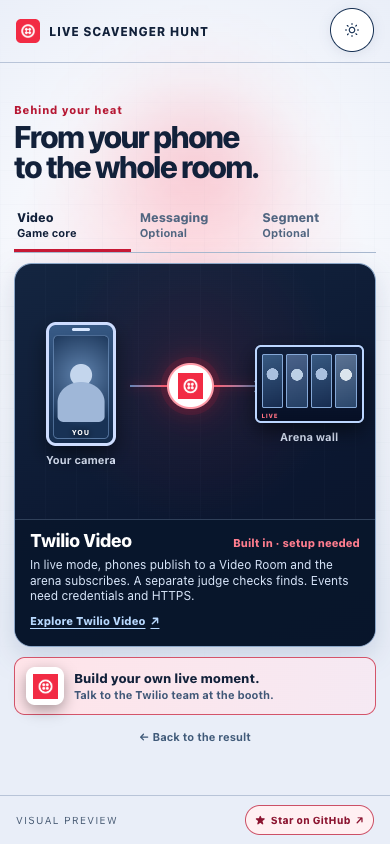</td>
  </tr>
</table>

<p align="center"><em>Read-only visual previews with lead capture off. When an event enables lead capture, its configured guide and expert request actions appear below the product story.</em></p>

| Product | Role in the activation | Setup state |
| --- | --- | --- |
| **Twilio Video** | Phone cameras publish into an unrecorded room; the booth wall subscribes to the players' video. | Built in; needs the Account SID, API Key SID and secret, Auth Token, and a public HTTPS origin for a live event. |
| **Twilio Messaging** | Spectators send SMS or WhatsApp ballots and receive an automated TwiML acknowledgment reply. A web ballot is available without a sender. | Optional; needs event senders, inbound webhook setup, and registration that covers the replies. |
| **Twilio Segment** | Can mirror a limited, contact-free activity stream. The local report works without Segment. | Optional Write Key. The app does not send lead identity to Segment. |
| **Twilio SendGrid** | Can email a requested build guide. Expert requests are saved for staff follow-up. | Optional API key and verified sender. |

Prompts use **OpenAI vision** by default when its server key is configured. Existing saved prompts switch to AI-assisted judging once on upgrade; later admin choices remain in place. Without an OpenAI key, an operator must judge AI-assisted rounds. The booth operator can always review or override a decision. The expert CTA records a request; it does **not** place a Voice call or launch Agent Connect.

## Player safety and booth control

The result screen offers **Play next heat** and **Leave game**. Replay keeps the player's alias and session, queues them for the next heat, and turns off the camera between heats; when a spot opens, the phone reconnects or offers a reconnect button. Leave ends the session and frees the spot. The header also offers Leave while queued, playing, or exploring the postgame story. A phone left idle in the queue, lobby, paused heat, or operator review asks “Still here?” after three minutes and releases the spot after another 30 seconds. An abandoned Leave confirmation also releases after 30 seconds. If the tab closes or stops sending heartbeats, the server clears waiting players after about 25 seconds and in-progress players after about 60 seconds. A finished player does not occupy a new slot until choosing replay; the camera stops at the end of the configured result display, with a time limit even if the result is paused.

<p align="center">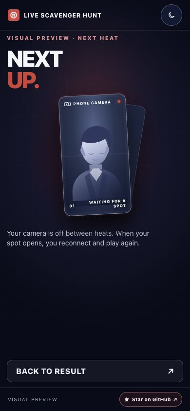</p>
<p align="center"><em>Next-heat visual preview. The portrait is an illustration; no live camera is shown.</em></p>

Staff can open **Manage players** in the operator view, choose a current or queued player, and confirm removal. Removal clears the slot, requests a Twilio Video disconnect when configured, invalidates that player session, and records a removal metric. The command reports whether the Video disconnect succeeded. This is session-level moderation: a person with a new browser session can scan again, so booth staff should monitor the arena.

## Quick start

Requires **Node.js 26+**. No Twilio credentials are needed for a local rehearsal.

```sh
npm ci
npm start
```

`npm start` builds the browser Video client before starting the server. On a new local database, the terminal prints a generated admin username and one-time password. Save the password, then open:

| Screen | Local URL |
| --- | --- |
| Arena wall | [Open arena](http://127.0.0.1:65111/e/live-scavenger-hunt/arena) |
| Player phone | [Open player](http://127.0.0.1:65111/e/live-scavenger-hunt/play) |
| Spectator ballot | [Open vote](http://127.0.0.1:65111/e/live-scavenger-hunt/vote) |
| Operator and event settings | [Open control room](http://127.0.0.1:65111/e/live-scavenger-hunt/operator) |
| Private metrics and leads | [Open metrics](http://127.0.0.1:65111/e/live-scavenger-hunt/metrics) |

The default server address is `127.0.0.1:65111`; adjust it with [.env.example](.env.example). Local rehearsal sends short-lived JPEG camera frames through the app at a lower frame rate than Twilio Video. Camera access on real phones requires a reachable **HTTPS** origin. Sign in as an operator in the same browser profile used for the arena wall to see player cameras there.

Hosted deployments can provide `BOOTSTRAP_ADMIN_PASSWORD` as a platform secret on first boot. The app then seeds the admin without printing the credential in retained server logs. Changing that secret after the first boot does not change the saved password; use **Team → Admin login** to update the existing account.

### Booth staff sign-in

The first local admin account is `admin`. In **Team → Admin login**, an admin can edit that existing account: leave the username as `admin` and enter a new password to reset it, change the username, or do both. A Google admin does not need the old local password. This updates the saved account and signs out its existing sessions. **Add operator** creates a separate staff account and cannot reuse `admin`. Team also lets admins create and manage local operators. Local passwords have no minimum length or character rule; any nonempty value up to a 16 KB request-safety ceiling works. Google account names and passwords remain managed by Google. Operators can run heats but cannot edit event settings, see leads or metrics, or manage other accounts. **Team** and **Metrics** appear only for admins. Local accounts work without Google or Twilio credentials.

Google sign-in is optional and appears when an OAuth client ID and secret are configured. Any Google identity with a verified `@twilio.com` address **and** the `twilio.com` Workspace claim receives admin access, including **Team**, **Metrics**, and leads. The server checks the signed ID token and tracks the stable Google subject rather than trusting the address alone. An existing Google operator gains admin access on their next verified sign-in. The [Azure setup guide](docs/INFRA_SETUP.md#optional-google-sign-in-for-twilio-admins) shows the exact callback URL and secret setup.

<table>
  <tr><th>Staff sign-in</th><th>Admin · Team</th></tr>
  <tr>
    <td>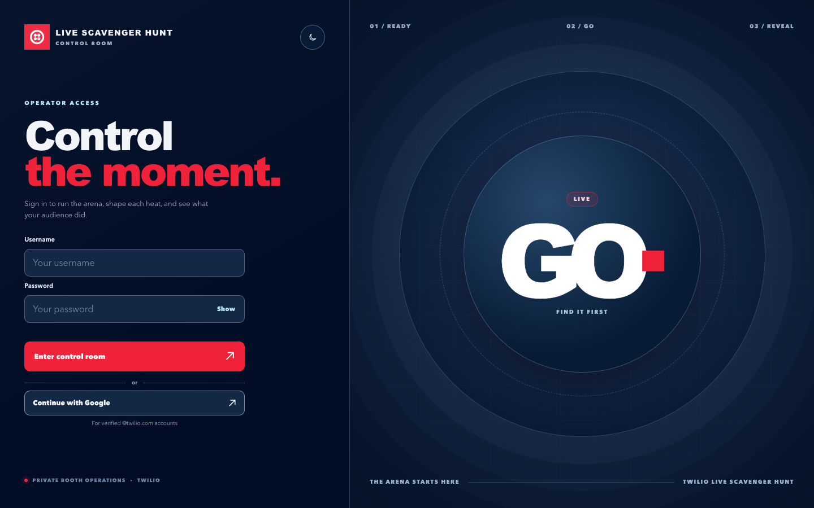</td>
    <td>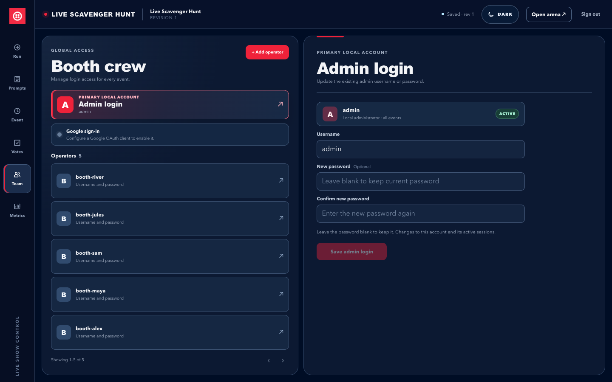</td>
  </tr>
</table>

<p align="center"><em>Local visual previews. The Google button appears when OAuth credentials are configured.</em></p>

Run `npm run check` for the browser build, server tests, and README link check. The [runbook](docs/runbook.md) covers event setup, accounts, preflight, messaging registration, data care, and a full booth rehearsal.

## Metrics and leads

The admin-only Metrics view filters by event and date range, shows the engagement funnel and outbound **Twilio page** and **GitHub repo** click counts, and exports filtered event or lead CSV. Twilio clicks are broken down by Video, Messaging, and Segment; GitHub referrals are attributed to the player phone, spectator ballot, arena QR, or arena link. Compact metrics screens keep the total visible, with source details in the report and event export. These counts record outbound actions, not confirmed page loads or GitHub stars. Local reports persist in SQLite even when Segment is not configured. Lead capture can be switched off per event; when on, an admin chooses up to eight fields and which are required. The phone keeps in-progress form fields during arena updates, and its keyboard Go action advances or sends the request. The guide and expert CTAs are optional. Marketing updates require a separate, unchecked choice.

The app stores event configuration, heat history, votes, metrics, and requested leads in SQLite. Video is not recorded by this app, and camera evidence JPEGs are kept briefly in memory rather than saved to the database. Lead retention is configurable per event.

## Architecture

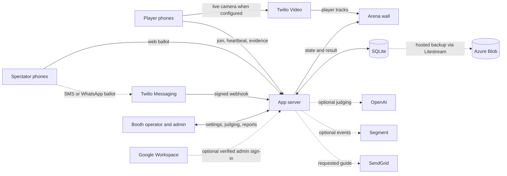

The server owns the round clock, sealed clue, slot assignment, winner decision, operator permissions, and event-scoped reports. The [API contract](docs/full-app-api.md) lists routes and payloads; the [challenge library](docs/concepts/find-it-first-challenge-library.md) helps plan an event prompt deck.

## Azure deployment

The [hosted arena](https://live-scavenger-hunt.delightfulwave-e00d5e3d.centralus.azurecontainerapps.io/e/live-scavenger-hunt/arena) runs on Azure Container Apps. Provisioning starts it in rehearsal mode; the operator **Preflight** view reports the current media configuration. Its public HTTPS URL supports phone camera permissions, and the four Twilio Video and Auth Token settings enable live Rooms. Local passwords work without Google; Google sign-in appears when its OAuth client credentials are deployed.

The Azure setup follows the Birdies & Eagles pattern: a dedicated resource group in `centralus`, private Container Registry, Container Apps environment, Log Analytics, and GitHub OIDC deploys. The app keeps SQLite on fast local container storage and uses Litestream to restore and replicate it to a private Azure Blob container. An Azure Blob lease allows only one replica to open the database, including during platform maintenance. A controlled rollout stops the previous game process before the replacement starts, so a release includes a brief planned pause. The Container App serves a public HTTPS URL and is configured for one replica.

Start with [one-time infrastructure setup](docs/INFRA_SETUP.md), then use the [deployment guide](docs/DEPLOYMENT.md) for releases, backup checks, and recovery. [CI details](docs/CICD.md) describe the `Validate` gate that runs before an image can deploy. GitHub Actions can activate live Video through the controlled rollout with four Twilio secrets and `TWILIO_VIDEO_MODE=live`; `rehearsal` switches back to snapshots, and an unset mode preserves the current setting. The same safe rollout accepts optional OpenAI, Segment, and SendGrid keys as GitHub Actions secrets; a verified SendGrid sender is also needed before requested guide emails can be delivered. Segment lead identification stays off unless explicitly enabled for visitors who separately opt in. Litestream attempts to sync every second when Blob is healthy; backup lag can grow during a storage outage. Verify a current backup and restore before an event.

## Production handoff

**The Azure deployment path is included and starts in rehearsal mode.** Before opening a public booth, add the Account SID, US1 Standard API Key SID and secret, and account Auth Token as GitHub Actions secrets; set `TWILIO_VIDEO_MODE=live` and deploy between heats. Verify the Blob backup and restore, then test the wall with real phones on the venue network. SMS/WhatsApp ballots are optional and need an inbound sender webhook plus registration for automated acknowledgment replies. AI vision, Segment, and SendGrid are optional integrations with [separate setup](docs/INFRA_SETUP.md#activate-optional-ai-segment-and-guide-email). Follow the [Twilio activation steps](docs/INFRA_SETUP.md#activate-twilio-video) and [runbook's handoff checklist](docs/runbook.md#8-production-handoff-checklist).

When changing app behavior, screens, settings, or integrations, update this README and the relevant runbook/API sections in the same change. [Project guidance](AGENTS.md) records that maintenance rule.
